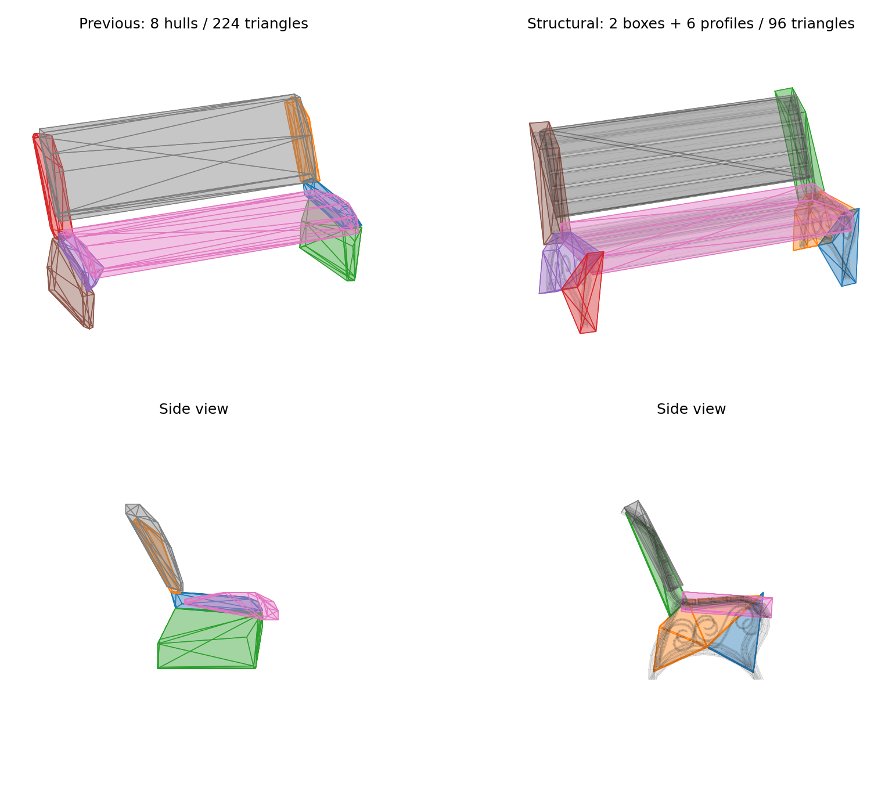

# Structural collision generation

The Collision tab starts its convex mode with **Structural: Boxes + Profiles**.
Use **Detailed** for the original whole-mesh V-HACD route, or **Coarse Parts** for
element preparation followed by V-HACD.

Structural generation follows the selected source LOD hierarchy in child order.
Each renderer node is an independent boundary, including separate instances of a
shared mesh. Within a mesh, geometric shared edges identify connected elements;
nearby elements with compatible principal planes can form a structural group.
A packed mesh with no authored child parts relies on this geometry analysis.

For each group, the generator first tries an oriented box. It compares both
surfaces and additionally samples a grid on every box face. An accepted box is a
final shape, not an input to another decomposition.

Thin groups use their least-thickness PCA axis as the extrusion direction. The
other two axes define one projection. A convex profile is extruded between the
group's depth bounds. Large empty regions in the projected footprint or excessive
sampled surface error trigger triangle clipping and independent profile fitting.
Splits retain faces crossing the plane. Profile reduction removes supporting
edges outward, preserving the outline and contact points. The smallest passing
profile is used; Max Verts/Hull is a ceiling, not a target.

If simple fitting cannot meet the tolerance and shared hull budget, the existing
element preparation and 3D decomposition handle that group. The analysis foldout
shows the source path, chosen shape, sampled fit and reason for each fallback.

**Shape Fit (%)** is relative to each group's oriented bounds diagonal. The
Structural preset uses 7.5%, with up to 8 shapes per source mesh and 16 vertices per mesh hull. Lower it
to retain more detail, potentially requiring more shapes or 3D decomposition.
This percentage is independent of V-HACD Volume Error. Surface and gap checks are
sampled estimates; they do not prove an exact distance bound or preserve every
small hole. Flat surfaces receive a minimum thickness of 0.1% of the group diagonal.

**Apply to Scene** uses a native BoxCollider for fitted boxes when both the local
and world transform can represent the box without shear. Otherwise it bakes the
full matrix into a convex mesh proxy. Placement and removal participate in Undo.
Preview, sidecar and FBX retain the matching mesh proxies. Sidecars additionally
save optional shape metadata; existing sidecars remain mesh-only. Reimport and
FBX export use the mesh proxies, not native Unity BoxCollider components.

On the packed Park_Bench_A LOD0 (3,832 source triangles), the Structural preset
produces two boxes for seat/back and six profiles for the side structures. The
portable proxies have 96 triangles, compared with 224 in the earlier Coarse
Parts result. Native boxes have no mesh triangle cost when applied to the scene.

This comparison renders the exported mesh data from the same source mesh and
camera; it is not a Unity preview screenshot. The original surface is shown in
gray behind the collision proxies.
