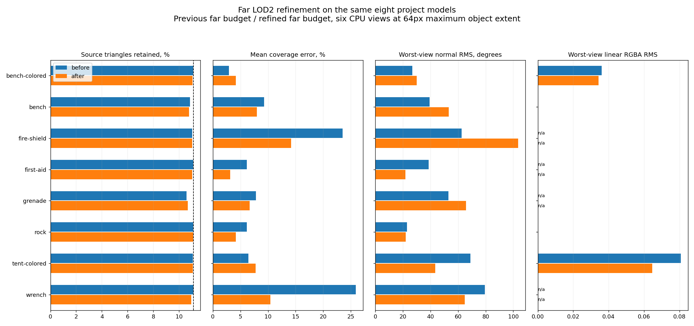
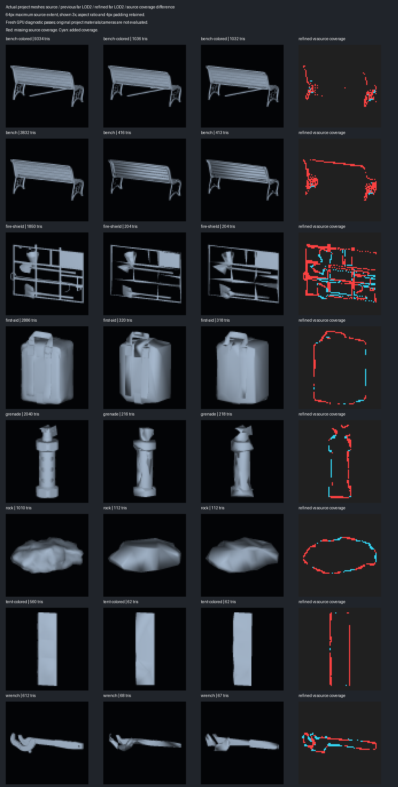
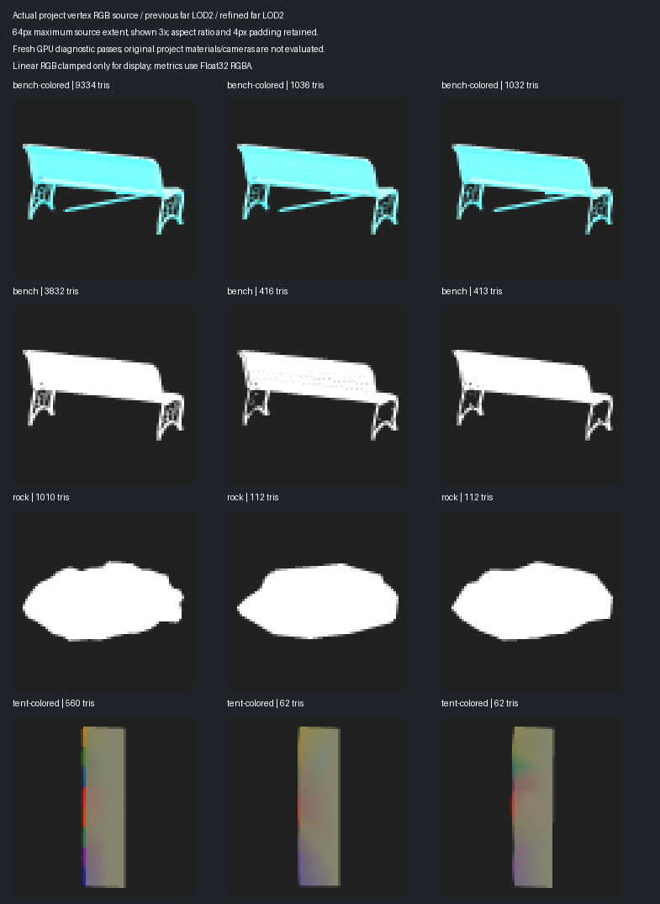

# Far LOD silhouette and visible RGBA refinement

This follows the [source-based far-budget stage](LOD_FAR_TRIANGLE_BUDGET.md).
The LOD0/1/2 sequence still requests approximately 1, 1/3 and 1/9 of
source triangles. LOD2 is independently generated from working LOD0. Source
FBXs, material slots, other vertex channels and LOD1 policies are retained.
No native bridge or distributed plugin binary changes in this stage.

## Geometry candidates and silhouette correction

The preceding fallback enabled permissive attribute-seam collapse only after
reducing authored normal/color weights almost to zero. Far generation now
tries permissive collapse with meaningful weights as well, and completes the
bounded six-probe sequence to retain the preceding geometry alternatives.
The first reached count no longer stops far quality exploration.

Selected far candidates with mean silhouette coverage error above 10% can try
a local position correction. Three deterministic coordinate-descent sweeps
use steps of 1, 0.5 and 0.25 source-extent pixels. Six source-framed CPU views
rank mean/maximum fractional coverage error. Sparse triangle coverage masks
and sample counts update only incident faces for each proposed displacement.

Indices and triangle counts never change in this correction. Coincident render
wedges move together; material interfaces shared by candidate vertices stay pinned.
Displacement is bounded by twice the source's largest local axis extent divided
by the configured object-pixel count. This is two source-extent pixels; a
foreshortened view can project a larger displacement.
Incident face orientation must remain in its original hemisphere, with a
minimum area relative to the input face. The correction is disabled with
`Lock Border`, for deforming meshes, above 512 target triangles or above a
128-pixel diagnostic footprint. These limits bound editor work and storage.

The candidate must improve its final source quality score without increasing
mean/maximum silhouette error, local detail loss or visible RGBA errors.
Unselected/rejected meshes are destroyed. A position-corrected result reports
sampled source error; the preceding native error bound does not apply after
vertex movement. Unchanged connectivity and face-orientation checks do not
certify absence of self-intersections or complete authored-topology retention.

## Visible color fitting

Far attribute correction adds paired visible samples from the same six
64-pixel source frames. Depth-tested source/target barycentric samples must
belong to the same material slot and compatible geometric face orientation.
Occluded geometry, another material or an opposite face cannot lend color.
Existing color-owner linkage and seam pins remain in effect.

Sparse RGBA least squares tries two regularization strengths, alongside the
preceding surface/area fits. Individual channels can accept different blends.
Every accepted far replacement must preserve local paint/detail guides,
normal-field error and **each of the four worst-view RGBA channel RMS values**.
At least one visible field error must improve. Quantized Color32 and authored
Float32/HDR channels are verified in their actual output format; alpha is
included. Surface RGBA RMS/max remain measured diagnostics in this explicit
far mode. Near-level surface and smoothing-region gates are unchanged.

For varying-color far sources, three cost variants include an RGBA-focused
alternative. Each candidate is corrected before final outer ranking. This
avoids selecting geometry solely on colors which would later be replaced.
Normal correction additionally checks screen error per trial, so a rejected
normal fit does not discard a separately useful color fit.

## Actual-model evidence

The final eight-model report, measurements and figures are generated with
`Tools~/render_lod_far_refinement.py`. The baseline is commit `df18859`'s
fresh far-budget captures. The new run regenerates source/native/near/far
controls from the same eight copied project FBXs. Original FBX hashes and
byte-identical source/native/near raw GPU controls are audited.

Primary metrics use six depth-tested CPU views at a 64-pixel maximum source
extent in a padded 72-pixel canvas. The separate front/oblique GPU views are
downsampled with the same source framing. Coverage is normalized against the
known preview background, which is subtracted before recovering covered
Float32 RGBA. Padding retains added coverage outside the source outline.
Figures show 64-pixel models magnified 3x; they use actual diagnostic GPU
captures rather than the project's original camera/material pipeline.

The copied FBX harness measures its existing largest eligible source mesh in
each asset. In particular, the colored tent case is the same mesh as the
preceding comparisons, rather than a newly combined whole-FBX object.

**215 selected EditMode tests passed**, zero failures or skips, on Unity
6000.2.6f2 / Direct3D12 / GTX 980 Ti. The final run includes the preceding
focused tests; their totals are not added to it. Both FBX compilation
configurations, identifier and dependency checks also pass. Eight models
produce 80 fresh variant/view capture sets. All 192 source/native/near raw
control passes match the preceding run. Previous far raw hashes and metrics
also match the portable baseline committed in `df18859`.

| Actual mesh | LOD0 | Previous / refined LOD2 | Mean silhouette error before / after | Worst-view RGBA RMS before / after |
|---|---:|---:|---:|---:|
| Colored bench | 9334 | 1036 / 1032 | 2.88% / 4.14% | 0.0361 / 0.0344 |
| Bench A | 3832 | 416 / 413 | 9.29% / 7.95% | 0 / 0 (constant white) |
| Fire shield | 1850 | 204 / 204 | 23.53% / 14.21% | n/a |
| First aid kit | 2886 | 320 / 318 | 6.18% / 3.14% | n/a |
| Grenade | 2040 | 216 / 218 | 7.80% / 6.68% | n/a |
| Rock | 1010 | 112 / 112 | 6.18% / 4.14% | 0 / 0 (constant white) |
| Colored tent | 560 | 62 / 62 | 6.46% / 7.75% | 0.0807 / 0.0645 |
| Wrench | 612 | 68 / 67 | 25.91% / 10.41% | n/a |

**8/8 LOD2 budgets pass**, retaining 10.69–11.09% of source triangles.
Wrench mean/max coverage error improves from 25.91%/31.47% to
10.41%/14.39%; fire shield improves from 23.53%/27.93% to 14.21%/16.54%.
Tent worst-view RGBA RMS improves by 20.04%, at the same triangle count.
Its selected candidate's pre/post correction channel errors are independently
recorded in the portable report; no visible RGBA channel worsens in the fit.

The separate GPU views confirm silhouette improvements on both requested
objects and color improvement on the tent at the same 64-pixel source extent:

| Object / GPU view | Coverage error before / after | RGBA RMS before / after | Headlight RGB RMS before / after |
|---|---:|---:|---:|
| Wrench / front | 22.50% / 15.62% | n/a | 0.2790 / 0.1436 |
| Wrench / oblique | 24.28% / 15.25% | n/a | 0.2022 / 0.1132 |
| Fire shield / front | 24.41% / 16.85% | n/a | 0.1250 / 0.1473 |
| Fire shield / oblique | 26.65% / 19.95% | n/a | 0.0971 / 0.1182 |
| Tent / front | 0.56% / 2.16% | 0.0193 / 0.0159 | 0.0909 / 0.0140 |
| Tent / oblique | 2.73% / 4.76% | 0.0340 / 0.0282 | 0.0346 / 0.0326 |

Quality is mixed, not uniformly improved. Fire-shield worst-view authored
normal RMS worsens from 62.53° to 103.62°, and its GPU headlight error also
worsens. Wrench normal RMS improves from 79.50° to 64.94°; tent improves from
68.99° to 43.54°. Tent and colored-bench silhouettes trade some accuracy for
their selected field/geometry quality. Bench A and grenade also worsen in
normal RMS. Both varying-color models still fail the sharp paint-boundary
guide. Attribute non-regression checks apply to replacements on a candidate;
the geometry selection score can trade normal accuracy for silhouette.

Measured two-level generation totals are 536.36 seconds for the refined far
profiles versus 377.12 seconds in the preceding stage (+42.23%). Native controls
take 342.30 seconds in this run, versus 357.63 previously. These are single-run
measurements, not a repeated performance benchmark. Extra far probes and
per-candidate visible fits add work, especially on the colored bench.

[Portable audited measurements](LOD_FAR_REFINEMENT_RESULTS.json)







Local raw captures and NUnit results: `_results~/lod-far-fidelity-20261010/final/`.

Reproduce the existing eight-case Unity harness with `-meshlabLodBudget
-meshlabLodHardEdges -meshlabLodFarBudget`. Audit/render the completed run:

```powershell
python -B Tools~/render_lod_far_refinement.py `
  _results~/lod-far-fidelity-20261010/final `
  --previous _results~/lod-far-budget-20261010/final `
  --output Documentation~/LOD_FAR_REFINEMENT_RESULTS
```

The sharp-boundary paint guide can still fail at this triangle count; lower
RGBA RMS is not complete category/boundary preservation. Normal RMS includes
authored normal signs and double-sided depth-tie sensitivity. Six-view ranking
is a heuristic, not a production-camera or all-view fidelity guarantee.
Better visible-component allocation, coarse normal reconstruction and
boundary-aware paint geometry remain follow-up work.
