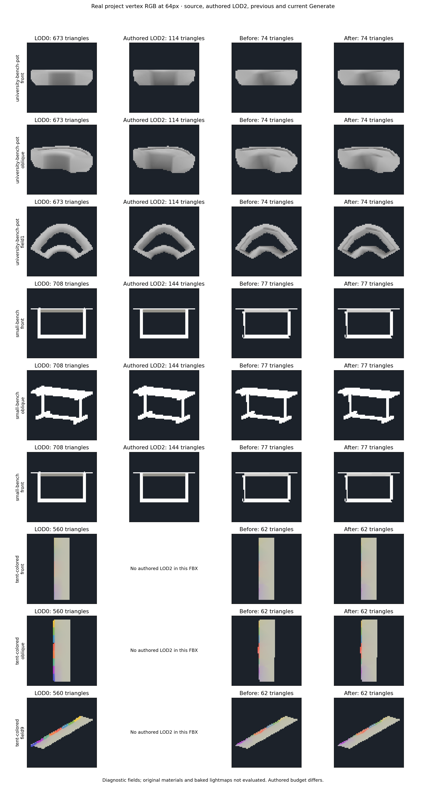
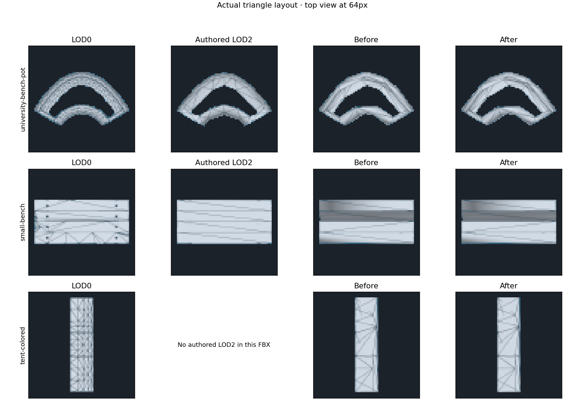
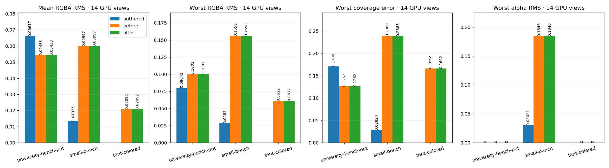
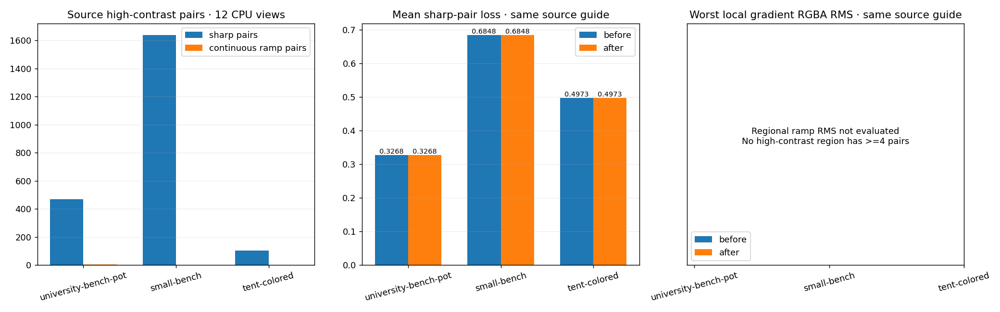

# Smooth RGBA fields and sharp paint boundaries — 2026-10-11

This iteration separates high-contrast continuous ramps from sharp vertex-paint
interfaces in the source guide. It retains the independent LOD2 target of 1/9
and rechecks University bench Pot, SmallBench and the rainbow tent at 64px.
The previous generated meshes are from `eeb6a0e`, recorded in
[the shared-corner report](LOD_SHARED_PAINT_PATCHES.md).

## Source guide

Faces join a continuous color region only across a verified, oppositely directed
geometric edge within one material slot, with matching endpoint RGBA to 1/255.
Nonmanifold edges, overlapping opposite triangles and material interfaces remain
separate. Normal, tangent and UV splits alone do not make vertex color sharp.
All eight source subsamples across a high-contrast pixel pair must belong to one
such region before the pair can be considered continuous.

Connectivity alone is insufficient: a connected field can contain a narrow stripe,
an abrupt slope change or a visible self-occlusion. A four-pixel source stencil
must also show a locally regular RGBA ramp: its neighboring differences agree
within max(1/255, 25% of the central difference). Incomplete stencils stay sharp.
Image-only GPU diagnostics use this profile test without claiming recovered mesh
topology. Classification uses the original, never the simplified result.

Sharp pairs retain the existing endpoint-color and contrast checks within a
common one-pixel correspondence. Continuous pairs use max-channel RGBA RMS,
measured separately per connected visible region and view. Missing support is
penalized. Regions of at least four pairs are guarded individually; a small mark
cannot disappear behind a better global mean. Lower-contrast gradients remain
covered by the existing full-image, per-channel and per-view RMS checks.

Final gradient fitting pins render corners supporting visible source sharp pairs,
in addition to actual duplicate RGBA seams and shared material vertices. The
remaining continuous colors can fit the original across twelve directions, with
the existing bounded priors and blends. Geometry, UV channels, indices and render
vertex count do not change during that fit. A failed proposal retains the input.
Bad gradient pairs also participate in diagonal correction; they are not passed
to the categorical per-polygon color stage.

The new `gradientWorstRegionRms`, `gradientMeanRms`, `gradientViewRms` and
`gradientRegionRms` fields report linear max-channel RMS, not percentages of lost
paint. Corrections guard these against both the original and most recent accepted
candidate, with a total allowance of 1/255. Sharp-pair metrics retain their original
meaning. Diagonals retain the previous six primary sharp-paint guards and twelve
channel/view guards, and additionally check twelve gradient views. The final RGBA
fit retains its twelve sharp-paint guards as well.

## Evidence

Every final LOD2 GPU color/coverage readback is byte-identical to the previous
Generate across all fourteen views. All exported mesh buffers also match exactly,
including UV2, indices and RGBA. The university's two shared diagonal corrections
and the tent's one isolated diagonal correction are retained. Additional gradient
fits are refused on these fixtures; captured quality does not improve this iteration.

| Fixture | LOD0 triangles | LOD2 triangles / vertices | Mean / worst GPU RGBA RMS, unchanged | Worst coverage error, unchanged |
|---|---:|---:|---:|---:|
| University bench Pot | 673 | 74 / 71 | 0.054331 / 0.100097 | 12.6184% |
| SmallBench | 708 | 77 / 125 | 0.059971 / 0.155752 | 23.8806% |
| Tent | 560 | 62 / 154 | 0.020920 / 0.061200 | 16.6172% |

Source topology plus the conservative profile test finds 470 sharp pairs and
three continuous ramp pairs across twelve university directions; SmallBench has
1640 / 0 and the tent 104 / 0. None form an eligible high-contrast ramp region of
at least four pairs. Their regional gradient RMS is **not evaluated**, rather than
evidence of perfect transfer. Lower-contrast smooth colors remain subject to
full-image RMS. Synthetic unit cases separately exercise steep continuous
RGB/alpha ramps, source normal splits, abrupt connected-field peaks, missing or
flattened color details, and independent regional error guards.

The previous meshes are measured again under the new guide. Twelve-view mean
sharp-pair loss stays 0.326752 / 0.684829 / 0.497312 for university / SmallBench /
tent. It must not be compared with the previous guide's unclassified-pair loss.
The complete color guide still fails on these assets. SmallBench retains worst
alpha RMS 0.184643; its thin frame and color allocation remain unresolved.
The two benches' LOD1 counts remain 673 and 500 versus targets 225 and 236.

Observed far two-level generation times are 27.47s / 41.26s / 23.15s. Timings are
one local run, not a speed benchmark. Real captures use Unity 6000.2.6f2,
Direct3D12 and a GTX 980 Ti. The object occupies a maximum projected source extent
of 64px; front, oblique and twelve source directions are compared. Linear RGBA RMS
uses common visible coverage; missing silhouette is reported separately.

**259 selected EditMode tests pass, with zero failures or skips.** This includes
the actual three-model Generate, cached GPU replay, smoothing/hard-edge,
color/alpha, shared UV2, budget, loop, cleanup and collision regressions. Seven new
cases cover classification, connected-field peaks, high-contrast gradient details,
regional error masking and participation of failed gradients in diagonal searches.
Both FBX compile configurations and the dependency/identifier/diff gates pass.

Full numeric evidence: [LOD_GRADIENT_BOUNDARIES_RESULTS.json](LOD_GRADIENT_BOUNDARIES_RESULTS.json).

## Next work

1. Improve SmallBench's thin-frame triangle allocation and RGB/alpha at 1/9,
   retaining its two material slots and using its authored LODs as references.
2. Extend local patch correction per material slot with the existing source UV2
   and intersection guards; recheck both benches, the colored park bench and tent.
3. Evaluate less restrictive local constraints for gradient fitting around sharp
   pairs. All 71 university corners and 154 tent corners end up pinned on this
   set; blanket source connectivity cannot safely authorize changing them.
4. Resolve protected LOD1 budget fallbacks and check original shaders and shared
   baked lightmaps in the project scene before production acceptance.

## Reproduction and limits

Use the same isolated readable, uncompressed copies and recorded FBX hashes as
[the bench audit](LOD_VERTEX_COLOR_BENCHES.md). University selects the Pot component,
not the separate Ground component or the whole prefab. Existing authored LOD1/2
are comparison controls at different budgets; the selected tent has no authored
LOD2 in its FBX. Source and authored GPU color/coverage readbacks must be
byte-identical between runs. Original project assets are not modified.

Run the real Generate test with the same three-case dataset and
`-meshlabLodBudget -meshlabLodHardEdges -meshlabLodFarBudget
-meshlabLodPaintDiagnostics -meshlabLodAuthored -meshlabLodAllColorViews`.
Add `-meshlabLodGuideBaseline <previous-output>` to evaluate the previous meshes
under the current source guide; older and newer sharp-only metrics cannot be
compared directly. Omit `-nographics` and `-quit` for GPU EditMode runs.

These are diagnostic RGBA previews and wireframes, not the project's original
material shaders or a shared baked lightmap. UV2 retention does not demonstrate
final baked lighting. Protected LOD1 budget fallbacks, SmallBench's thin frame
and its weak RGB/alpha views remain separate work.
