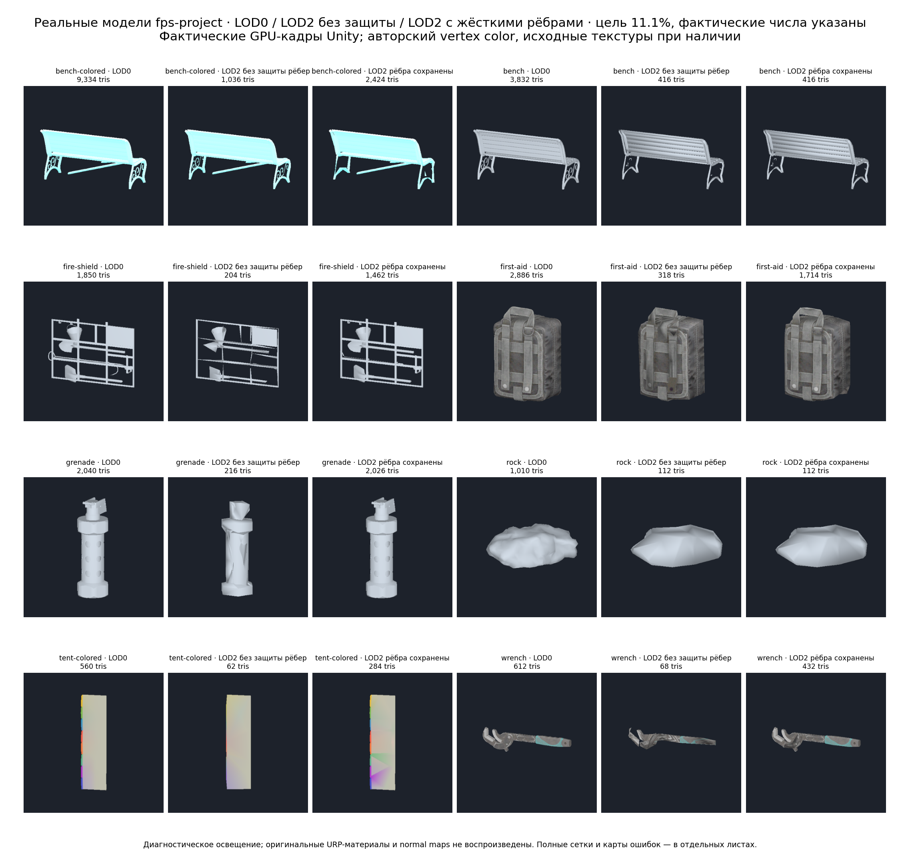
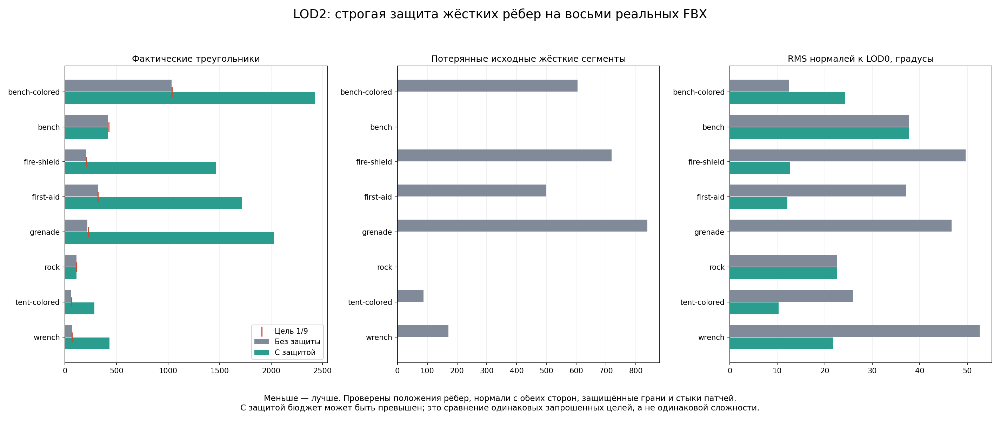
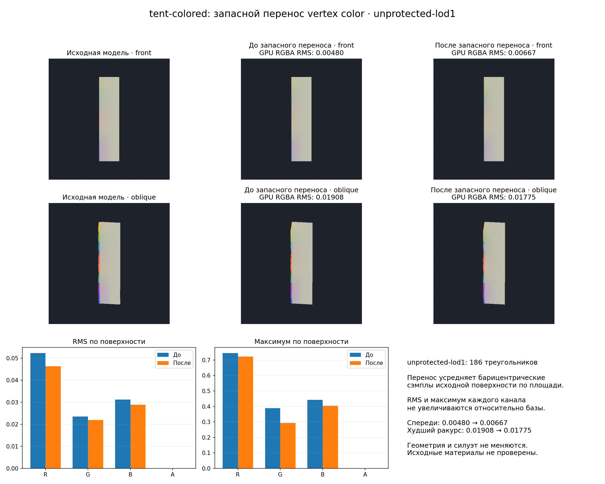

# LOD iteration handoff — 2026-10-10

Iteration [#229](https://github.com/SashaRX/UnityMeshLab/pull/229) was merged into main and released as 1.1.37. The complete LOD quality roadmap is not finished. The intended hierarchy remains LOD0, LOD1 and LOD2, with independent source reduction to approximately 1/3 and 1/9 of LOD0.

The subsequent [feature-chain experiment](LOD_FEATURE_CHAINS.md) adds an optional managed prepass with original-polyline/shading checks, contact/component isolation and quality-ranked native retries. The [native-constraint follow-up](LOD_NATIVE_CONSTRAINTS.md) now allows neighboring patches to retriangulate while preserving validated creases, junctions, material borders and ambiguous faces. Both options remain disabled by default. The snapshot below describes the preceding merged iteration, rather than these unmerged follow-ups.

Latest follow-up verification: **183 selected EditMode tests passed**, with all eight meshes and 176 variant/view GPU captures freshly evaluated at a physical 384×384 target. Native builds and CTests passed on Windows/Linux/macOS through CI. Native constraints reach 6/16 source budgets; only 2/8 LOD2 budgets pass, and Bench B LOD2 selects a reported strict-belt fallback. At matched counts, Wrench/First Aid Kit/Fire Shield LOD2 normal RMS improves 67.8%/48.6%/54.7%; tent LOD2 RGBA RMS improves 30.5% at exactly 280 triangles. Other color/normal/silhouette regressions and slow native retries keep this experimental. Details, portable graphs/data and the next checks are in the native experiment. The 177-test managed-prepass comparison remains its historical control.

## Implemented

The latest **vertex-color boundary stage** fits independent render corners on the
selected far mesh, without adding triangles or moving geometry. Uniform and
boundary-weighted source-visible fits are checked after Color32 quantization;
Float/HDR and alpha remain supported. Samples cannot borrow from a different
material or opposite-facing face. Mean and per-view boundary loss now accompany
the worst-region guide, and every measured view's boundary loss must not increase.
The pass requires a strict mean-boundary gain, unchanged silhouette/detail/normal
guides and non-increasing worst-view RGBA/channel RMS. Rejected/cancelled expanded
meshes are released; authored positions, normals, tangents and all UV dimensions
are retained. Near LODs, deforming meshes and disabled color validation bypass it.

**226 selected EditMode tests passed, zero failures/skips**, with fresh Generate
captures of the actual tent and colored bench at a 64px maximum source extent.
A further 31-test run recaptured the tent's opposite side with the final code;
its existing six-view measurements and front/oblique raw readbacks exactly match
the complete run. The overlapping test counts are not additive. Both FBX compile
configurations and static identifier/dependency checks pass. Both models' source/
native/LOD1 controls, plus far coverage/wire/headlight readbacks, match the previous
`9c47d01` stage byte-for-byte. Other six models were not freshly recaptured here.

| Mesh | Source → LOD2 triangles | Previous → new worst RGBA RMS | Mean boundary loss before → after the final pass | Render vertices before → after |
| --- | ---: | ---: | ---: | ---: |
| Colored bench | 9334 → 1032 (9.04×) | 0.03437 → 0.02605 (24.2% lower) | 5.28% → 3.93% (25.6% lower) | 1064 → 3096 |
| Tent | 560 → 62 (9.03×) | 0.06452 → 0.03251 (49.6% lower) | 86.11% → 50.09% (41.8% lower) | 48 → 186 |

The mean-boundary columns compare the current selected mesh immediately before
and after the corner pass, not an unavailable six-view mean from the preceding
iteration. Tightened per-view gates also affect the ordinary fit: the bench's
pre-corner RGBA RMS is 0.03849. Independent GPU RMS improves 11–14% for the bench
and 46–53% for the tent across the existing two 64px views. The bench's previously
lost front pair is retained; its worst CPU region reaches the 25% guide. Tent's
worst region still loses 100%, so categorical boundary acceptance remains false.
The existing GPU tent views and the additional opposite side contain no eligible
sharp pairs at this footprint; these are RGBA field checks, not a GPU paint-pass
claim. No categorical labels or original material semantics are recovered.

Render-vertex overhead is material: the source meshes have 5994/396 vertices,
while the accepted far meshes have 3096/186. Selective corner sharing is a next
optimization; the approximately 1/9 claim applies to triangles. Recorded far-
profile generation times are 344.39s/13.68s versus 322.81s/13.07s, including both
levels; these single-run timings do not measure game rendering performance.

Portable evidence: [numeric report](LOD_COLOR_BOUNDARIES_RESULTS.json),
[actual vertex fields](LOD_COLOR_BOUNDARIES_RESULTS_MODELS.png),
[error graphs](LOD_COLOR_BOUNDARIES_RESULTS_ERRORS.png),
[additional opposite-side capture](LOD_COLOR_BOUNDARIES_RESULTS_PAINT_SIDE.png).
Raw captures and `tests.xml`: `_results~/lod-color-boundaries-20261010/final/`,
`paint-surface/` and `corners-reverse/`. An opt-in real-model cost study found that
stronger native RGBA weights distort the tent or exceed its budget; those costs
are not a production profile change. Weighting the unchanged shared vertices
alone did not improve either model. No native ABI/binary or public setting changes.

```powershell
python -B Tools~/render_lod_color_boundaries.py _results~/lod-color-boundaries-20261010/final --previous _results~/lod-components-20261010/final --paint-surface _results~/lod-color-boundaries-20261010/paint-surface --output Documentation~/LOD_COLOR_BOUNDARIES_RESULTS
```

The preceding **far geometry stage** adds one independent LOD0 candidate for static,
non-varying-color meshes with at most 512 target triangles. It retains the
configured normal cost while omitting UV/RGBA costs during that probe, then runs
the existing attribute and shared-lightmap correction. Selection requires better
source quality and no regression in six-view mean/worst silhouette, local detail
or color guides. Authored channels, material slots and Lock Border are retained;
cancellation releases both the new probe and the preceding candidate.

**221 selected EditMode tests passed, zero failures/skips**, on Unity 6000.2.6f2;
all eight actual models were regenerated and recaptured. Both FBX compilation
configurations and the identifier/tool-dependency checks pass. All eight LOD2
budgets remain at approximately 1/9. Fire shield changes 204→200/1850 triangles
(9.25× reduction); six-view mean silhouette mismatch changes 14.21→12.56%, worst
16.54→15.53%. First aid changes 318→316 triangles and mean mismatch 3.14→1.26%;
Bench A changes 413→424 and 7.95→6.40%. The other five LOD2 outputs, including both
varying-color meshes, retain identical raw coverage/color/shaded captures.
Source/native/LOD1 controls are byte-identical throughout the eight-model run.
The added probe has a generation cost: fire-shield far-profile time in this run
is 36.86s versus the preceding 32.97s (both generated levels included). These
single-run timings are diagnostics, not a stable performance benchmark.

With the actual shared Level_Plan Bakery atlas and the same renderer binding,
fire-shield overlapping baked RGB RMS improves **23.39–23.98%** for irradiance
and **40.46–42.22%** with direction. The integrated UV2 transfer is accepted on
26 faces, with 305 render vertices after chart splits. The authored FBX LOD2 has
303 triangles and still preserves silhouette better: front/oblique mask mismatch
8.68/9.92%, versus generated 16.74/18.56%. Thin-strip distortion remains visible.
Diagnostic headlight RMS worsens 0.1442→0.3026; this is a shared-lightmap
improvement, not a general dynamic-lighting improvement. Original PBR materials,
normal maps, complete scene composition and filtered/packed atlases are still
outside this verification.

Portable evidence: [numeric report](LOD_FAR_GEOMETRY_RESULTS.json),
[actual-model comparison](LOD_FAR_GEOMETRY_RESULTS_MODELS.png),
[budget/error graphs](LOD_FAR_GEOMETRY_RESULTS_ERRORS.png).
Fresh raw captures and `tests.xml` are under
`_results~/lod-components-20261010/final/`; the original-FBX inspection control is
under `_results~/lod-original-fire-20261010/`. Reproduce the portable artifacts:

```powershell
python -B Tools~/render_lod_far_geometry.py _results~/lod-components-20261010/final --previous _results~/lod-far-normals-20261010/final --previous-bake _results~/lod-far-normals-20261010/shared-bake --originals _results~/lod-original-fire-20261010 --output Documentation~/LOD_FAR_GEOMETRY_RESULTS
```

Whole-component allocation, position welding and stronger corner/regularization
probes failed the measured non-regression checks and are not shipped. This stage
does not introduce a native plugin/ABI change or a new public setting.

The [far normal stage](LOD_FAR_NORMALS.md) retains all eight approximately 1/9
budgets and silhouette/RGBA controls while improving the fire-shield normal field.
The user confirmed shared LOD0 lightmaps and supplied the actual `Level_Plan /
TransformerStation_Building / FireShield` instance. The [shared-atlas follow-up](LOD_SHARED_LIGHTMAP.md)
now reads its actual Bakery bake and applies conservative UV2 chart transfer to
large far faces when a supported source-renderer binding is assigned. Fire shield
retains 204 triangles; 17 faces change UV2, vertices rise 259→288 and independent
64px baked RGB errors improve by 0.66–1.05% in both views/fields. The lighting
roadmap remains incomplete: mipmapped/packed bindings, stronger chart-boundary
preservation and complete original-material/scene validation remain next.

The [far silhouette and RGBA refinement](LOD_FAR_REFINEMENT.md) passes **215 selected tests** on the same eight models, keeping **8/8 LOD2 budgets near 1/9**. Wrench mean silhouette error drops from 25.91% to 10.41%, fire shield from 23.53% to 14.21%; tent RGBA RMS drops from 0.0807 to 0.0645 at 62 triangles. Bounded position correction keeps indices/counts intact; varying-color candidates receive visible fits before ranking. Fresh source/native/near raw controls are unchanged. The report records trade-offs: fire-shield normals/headlight error worsen, tent/colored-bench silhouette errors increase, paint boundaries still fail, and measured far-profile generation adds 42.23% work. Coarse normal reconstruction and visible component preservation remain next steps.

The [far triangle-budget stage](LOD_FAR_TRIANGLE_BUDGET.md) enables a source-based LOD2 screen-budget profile in LOD Gen. **211 selected tests pass** with fresh native/far comparisons on all eight models; **8/8 LOD2 budgets reach approximately 1/9**. Exact crease/face belts become diagnostics on the far profile; Lock Border and material slots are retained. Six-view silhouette, normal/RGBA fields and local detail/paint guides are ranked at 64 pixels. Colored bench improves several measured errors, while wrench/fire-shield silhouette and other normal/paint regressions still require review. This completes the far-count step, rather than the full fidelity roadmap.

The [far-screen calibration](LOD_FAR_SCREEN_FOOTPRINT.md) evaluates the optional local guide at a 64-pixel maximum object extent for LOD2 and later, matching the intended small on-screen footprint. 206 distinct selected tests pass, including fresh tent/colored-bench generations. Local detail checks now pass at that size; paint guides still fail and selected geometry is unchanged. LOD1 keeps its preceding diagnostic size. Protected-budget limits and the remaining geometry work still apply.

The latest [screen-acceptance stage](LOD_SCREEN_ACCEPTANCE.md) adds local thin-detail and sharp RGBA-boundary diagnostics at three footprints. **196 selected tests pass**, with 528 comparisons on the prior eight-model GPU readbacks and a separate fresh tent generation/capture. The tent proves lower RGBA RMS can still accompany worse sharp-boundary retention. These diagnostic gates do not yet change candidate selection or generation defaults.

- Independent per-level settings and source-based budgets; multiple meshoptimizer candidates ranked by measured geometry, silhouette, normals, UV and RGBA errors.
- Verified normal and vertex-color correction, including connected smoothing regions and correction non-regression checks. Regions represent authored normal continuity, not recovered DCC smoothing-group IDs.
- Raw FBX topology preparation through temporary imports without changing the original FBX; conservative full-loop and disconnected-small-part experiments.
- Optional strict hard-edge preservation. LOD Gen enables it by default; existing direct simplifier/pipeline callers opt in. Protected triangles and patch interfaces are validated before and after correction. No native ABI or distributed binary changes.
- Known protected-face floors prevent futile aggressive retries. Eligible preceding source-derived geometry can cap increasing density; it is cloned and remeasured, never recursively simplified.
- PR review fixes preserve edited working sources and preflight bindings during regeneration. Clearing previous generated LODs, prefab unpacking and generation share one Undo transaction; cancellation or an exception restores previous objects, mesh ownership and context entries, and releases pending meshes. The tool displays the failure and repaints. Regression cases cover working-quad/RGBA regeneration, cancellation between renderers/levels, and both cancellation and failure after clearing previous generated levels.
- RGBA fitting shares variables across equal-color render duplicates connected through unambiguous adjacent edges in one material slot. Disconnected contacts, ambiguous adjacency and material boundaries remain separate and conservatively pinned. Region pinning happens once per projection pass; identical mesh arrays bypass repeated whole-array comparisons. QSlim's experimental worker reports an empty prepared source instead of dividing by zero.
- Rejected varying-color fits now try area-weighted redistribution of the same source barycentric samples. Shared variables, pinned seams, Float/HDR/Color32 storage and per-channel RMS/maximum gates remain enforced. Successful ordinary fits skip the extra trials. On the actual tent's unprotected LOD1, maximum-channel surface RMS improves from 0.05224 to 0.04638 (11.2%); protected outputs and other tested outputs retain their previous fields. One GPU view worsens while the worst-view error improves; categorical-paint semantics remain unverified.
- Reproducible Unity GPU evaluation on eight actual project FBX meshes and an experimental libigl QSlim comparison. QSlim is a test/tooling experiment, not a production dependency or selected backend.

## Verified snapshot and limitations

The post-review baseline passed **162 selected LOD and collision EditMode tests**, with zero failures or skips, on Unity 6000.2.6f2. All eight actual FBX models were freshly recaptured after the Undo, RGBA-seam and performance fixes; no preceding GPU captures were reused. Both FBX compilation configurations, identifier and tool-dependency checks pass. Earlier 112/113/155-test runs remain historical evidence in [the evaluation](LOD_PROJECT_VISUAL_EVALUATION.md). These are selected checks, not a complete package-suite claim.

All 3019 authored hard-edge segments are retained at both generated levels, with zero missing protected face occurrences or patch interfaces. All 1660 measured regional correction checks pass. Nevertheless, strict protection currently reaches only 5 of 16 triangle budgets and only 2 of 8 LOD2 budgets. Equal adjacent counts can be a genuine protected-geometry limit.

The full eight-model RGBA comparison also passed 162 selected tests. Final verification passed **166 selected tests** with a fresh tent GPU capture, including rollback when a reducer returns failure and accurate preparation failure/cancellation statuses. Failed renderers abort the transaction rather than committing missing surfaces; preparation never reports success after failure or cancellation. Seven other captures retain the full comparison's lineage: their resampling trials all lost, and the final optimization only skips those trials. Their recorded timings/trial counts belong to that full experiment. Final artifacts: `_results~/lod-iteration-closure-20261010/final-color-fallback/`; test results: `final-preparation.xml` in its parent directory.

| Project mesh | LOD0 | Protected LOD1 | Protected LOD2 | LOD2 target |
| --- | ---: | ---: | ---: | ---: |
| Park Bench B | 9334 | 3112 | 2424 | 1038 |
| Park Bench A | 3832 | 1269 | 416 | 426 |
| Fire Shield | 1850 | 1502 | 1462 | 206 |
| First Aid Kit | 2886 | 1852 | 1714 | 321 |
| M84 grenade | 2040 | 2026 | 2026 | 227 |
| Rock | 1010 | 336 | 112 | 113 |
| Rainbow tent roof | 560 | 284 | 284 | 63 |
| Wrench | 612 | 468 | 432 | 68 |

Preserving each original crease segment is too conservative for useful reduction on several meshes. Bench B's worst silhouette mismatch worsens from 2.372% to 7.456%, despite retaining more triangles. Vertex-color RMS can improve while categorical paint boundaries still visibly interpolate incorrectly. Budget mode reports exceeded quality guides rather than treating them as certified acceptance limits. Full-loop reduction has not produced a practical gain on this project dataset.

Detailed implementation: [LOD controls and operators](LOD_FULL_LOOPS.md). Research: [topology and libraries](LOD_TOPOLOGY_RESEARCH.md). Test evidence, reproduction commands and capture lineage: [real project evaluation](LOD_PROJECT_VISUAL_EVALUATION.md). Workstation-only post-review artifacts are under `_results~/lod-iteration-closure-20261010/final-eight-models/`; copied project models and experimental Python dependencies are intentionally outside the package.







The overview/chart retain the final capture lineage above; their LOD2 fields/counts remain identical to the post-review baseline. The RGBA figure compares that baseline with the final tent capture. Source hashes, feature/region checks and unchanged source PNG checks: `final-color-fallback/audit.json`. Integration PR: [#229](https://github.com/SashaRX/UnityMeshLab/pull/229).

## Next iteration, in order

Priority after this color stage: reduce unnecessary render-corner duplication
without losing the verified field/boundary gains, then align coarse tent edges
with the remaining lost paint regions at the same 1/9 budget and 64px footprint.
Extend UV2/chart-boundary and filtered lightmap checks to more assigned project instances.
Thin-strip distortion on the fire shield remains a geometry follow-up, with the
authored 303-triangle control kept visible. Exercise complete materials/assemblies
and LOD transitions after those checks. Shared bindings currently support only
unmipped full-HDR atlases.
Keep lighting/color fidelity ahead of exact normal-region matching for LOD2.

1. Native crease/junction constraints and the matched-count comparison are implemented and verified as an optional experiment. Remaining work in this stage: diagnose low-budget coverage failures, quality regressions and expensive retries; keep the strict/coarsened controls and rebuild native changes through CI.
2. Local screen diagnostics and an optional CPU guide for candidate ranking, attribute-correction refusal and whole-small-component removal are implemented. See [screen-guided selection](LOD_SCREEN_GUIDED_SELECTION.md) for the fresh comparison and remaining limits. Next: calibrate thresholds at actual screen sizes, profile extra cost and address Bench A/Fire Shield thin details and the tent's RMS-versus-boundary tradeoff. Categorical labels and original-material acceptance remain unverified.
3. Exercise original materials, normal maps, complete assemblies and LOD transitions in the project's render pipeline. Separate geometric silhouette, shading and color errors in the report.
4. Revisit full-loop removal on irregular project topology. Keep source provenance and topology/winding/intersection validation; require a measured reduction benefit before changing defaults.
5. Reconsider QSlim as an additional candidate only after equivalent attribute, topology, crease and quality checks. Any necessary native plugin change must be rebuilt through `build-native.yml`.

Keep every stage independently reviewable. Preserve working LOD0, source FBX bytes, material slots, owned-mesh cleanup, cancellation and Undo/LODGroup restoration. Do not label the system complete until the factor-three budgets and visual acceptance hold on the real project dataset.
