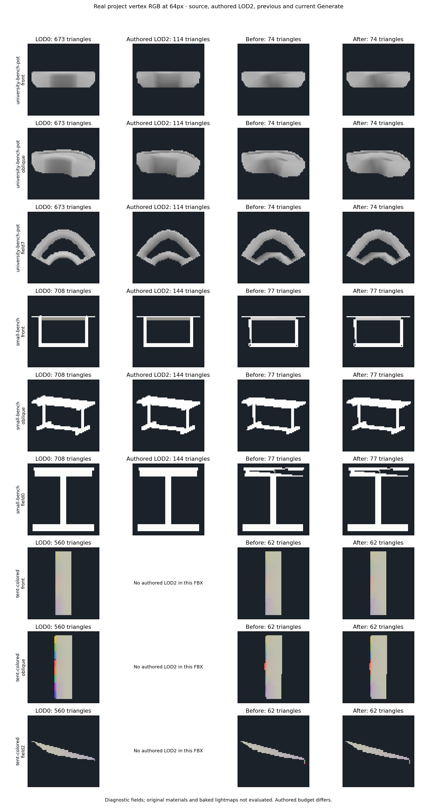
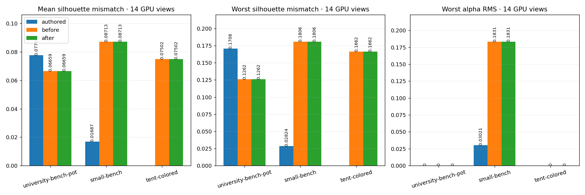

# Far LOD experiment closure — 2026-10-11

The automatic vertex-color/silhouette tuning series is **closed**. Retain the
generator from `7739c46`; this final source-component allocation attempt did not
meet its quality gates. No allocator, additional native probes or allocation
tests remain in the shipping code. Missing thin members are a known limitation
of the retained SmallBench LOD2, not a completed quality improvement.

## Last bounded attempt

SmallBench contains 24 exact-position-connected components: long frame members,
four seat boards, feet and eight small fasteners. Uniform submesh reduction
spends the same source-triangle fraction on parts with very different visibility.
The alternative generated each component independently from **LOD0**, tried
2/4/6/8/12/16-triangle native reductions, and used a deterministic budget dynamic
program to minimize footprint-weighted local silhouette error. Only parts whose
maximum extent was at most two pixels at the 64px object footprint could receive
zero triangles. Material slots, float RGBA, UV dimensions and component isolation
were retained. The final candidate used the existing source attribute transfer
and was then checked against the retained mesh across twelve CPU directions.

The 79-triangle global budget produced **78 triangles** with component allocations
`[4,2,4,2,16,4,4,4,4,2,2,2,0,0,0,0,0,0,0,0,12,8,4,4]`.
Removing eight small fasteners did not provide enough useful budget to retain
the frame and its source UV correspondence under this allocation method.

| CPU guide / source correspondence | Retained 77-triangle mesh | Rejected 78-triangle candidate |
|---|---:|---:|
| Mean silhouette error, 64px | 8.00% | 10.63% |
| Worst silhouette error, 64px | 18.00% | 16.83% |
| Worst lost thin-detail region | 5.80% | 25.00% |
| Source distance RMS | 0.014734 | 0.008235 |
| Protected UV RMS | 0.136423 | 0.337572 |

The table compares the primary mean/worst silhouette and source metrics; detail
and rejected RGBA/paint diagnostics also retain the complete twelve-view report
in the linked JSON. The primary and all-direction means differ slightly due to
view-dependent rasterization. The allocation's lower worst silhouette error and
source distance do **not** compensate for worse mean coverage, lost frame regions
and UV correspondence. It was refused; no tolerance or UV/color requirement was
relaxed to accept it. The local component objective also ignores occlusion by
neighboring components, which limits its ability to predict whole-object quality.

SmallBench's observed two-level far-generation time rose from **104.14s to
123.00s** with the rejected allocation. Those are single-run timings, not a speed
benchmark. Removing the allocation restores the earlier code path rather than
shipping another expensive rejected alternative.

## Final real-model verification

The isolated Unity 6000.2.6f2 project ran actual Generate on the **same three FBX
copies**, including source/authored controls and fourteen physical GPU directions
at the **64px object footprint**. The final selected meshes and GPU results are
identical to the prior silhouette iteration. Source hashes were rechecked; source
and authored coverage/color readbacks are byte-identical to the baseline. These
are diagnostic geometry/vertex-RGBA captures, not original-material or baked
lightmap acceptance.

| Mesh | LOD0 triangles | Final LOD2 triangles / vertices | GPU mean / worst silhouette error |
|---|---:|---:|---:|
| University bench Pot | 673 | 74 / 71 | 6.659% / 12.618% |
| SmallBench | 708 | 77 / 125 | 8.713% / 18.064% |
| Rainbow tent | 560 | 62 / 154 | 7.502% / 16.617% |

**237 selected EditMode tests passed; zero failures or inconclusive results.**
Five unrelated opt-in experiments were ignored because their separate inputs
were not requested: raw color-cost candidates, paint-diagonal replay,
paint-geometry replay, original-project authored capture and existing-readback
screen acceptance. The actual three-model Generate test and all four new
allocation cases passed, including channel/slot retention, deterministic output,
an impossible thin-member budget, deformation/border refusal and cancellation
cleanup. These allocation cases are archived in the rejected patch with the
prototype. Both FBX compile configurations passed with zero errors.

The graph tool explicitly records the five ignored cases with their reasons when
`--allow-unrequested-experiments` is supplied. All final mesh/GPU/hash/budget/color/
surface checks remain enforced, and required actual Generate must pass. Its
default still refuses any ignored test. No additional opt-in experiment was run
to manufacture an all-green test count.

[Portable measurements, rejected candidate and test status](LOD_PART_ALLOCATION_FINAL_RESULTS.json).
The refused candidate's measurements are in SmallBench's `budgetCandidates`
entry named `source component allocation`. Its table is a **CPU guide**, not a
GPU render of the refused mesh; GPU images show the actual selected final meshes.

## Frozen decision and remaining limits

- Keep the conservative sharp-boundary/continuous-gradient color transfer and
  the bounded silhouette refit from `7739c46`.
- Keep the requested LOD0/LOD1/LOD2 hierarchy and source-based reduction; the
  tested final LOD2 budgets remain at or below `ceil(LOD0 / 9)`.
- End automatic parameter/algorithm experiments on these fixtures. No further
  allocator/color/silhouette tuning is scheduled.
- SmallBench still loses thin details. Its authored **144-triangle** LOD2 has
  much better coverage than the retained 77-triangle automatic result. That
  comparison does not prove a 79-triangle solution is impossible; it identifies
  the current algorithm's limit. If that asset must preserve the full frame,
  use an authored exception or approve a larger per-asset budget separately.
- Protected LOD1 budget fallbacks, generation speed, original materials and
  shared baked-lightmap acceptance remain ordinary integration work. This
  closure is **not** a claim that the entire LOD system is production-ready.

The implementation attempt is archived as
[LOD_PART_ALLOCATION_REJECTED.patch](LOD_PART_ALLOCATION_REJECTED.patch), based on
`7739c46`. Reproduction requires an explicit new experiment: apply it to that
commit, then run the existing copied-model Generate test with the three-case
dataset, `-meshlabLodBudget -meshlabLodHardEdges -meshlabLodFarBudget
-meshlabLodPaintDiagnostics -meshlabLodAuthored -meshlabLodAllColorViews
-meshlabLodGuideBaseline <7739c46-output> -meshlabLodSilhouetteRegression`.
The completed attempt is in `D:/Temp/UnityMeshLab-lod-allocation-20261011/run`;
the closed isolated test project is
`D:/Temp/UnityMeshLab-lod-silhouette-3437-20261011`. Original project assets were
not edited. Do not reopen the experiment automatically.
