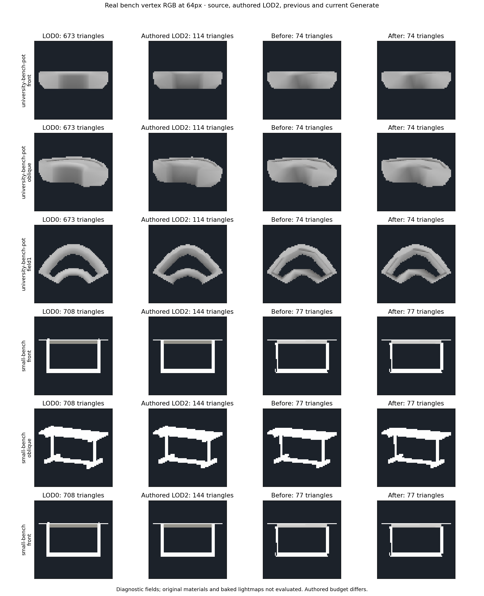
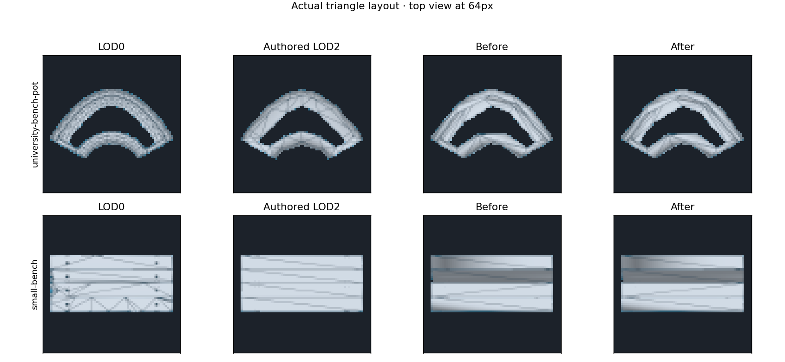
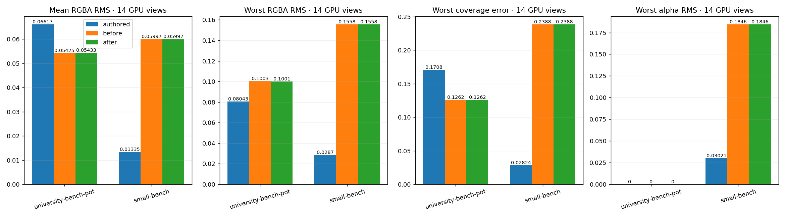

# Shared-corner LOD paint refinement — 2026-10-10

The following source gradient / sharp-boundary iteration is recorded in
[LOD_GRADIENT_BOUNDARIES.md](LOD_GRADIENT_BOUNDARIES.md).

This iteration uses the university bench's actual authored LOD1/LOD2 as topology
and color references. It extends the generator to shared render corners; it does
not substitute the authored LOD or raise the generated LOD2 budget.

## Changes

The source-paint diagonal stage can now change triangle indices across a shared
render edge. It retains every vertex field and all other incident triangle indices.
Partially duplicated edges remain pinned because they can encode a seam. Material
slots remain isolated; the current diagonal stage still supports one slot only.
Opposite-diagonal uniqueness, convexity, winding, nearly coplanar faces, new sheet
intersection checks, source surface distance and UV2 error guards remain required.
Shared pairs retain UV2 directly; isolated pairs retain the existing bounded UV2
refit. No render vertices or triangles are added.

A shared pair may improve interpolated RGBA while retaining paint loss, or improve
paint loss while retaining worst RGBA. Six primary paint/detail views must retain
or improve; twelve RGBA views retain the existing 1/255 per-channel/view allowance.
Silhouette, sampled source distance and sampled shared-atlas UV2 remain guarded.
This is a local diagonal correction, not deletion of complete polygon loops.

An additional final field fit samples the original across twelve directions after
the geometry has been selected. Equal-color copies on independent sheets can be
fitted independently instead of being frozen solely due to coincident positions.
Actual RGBA discontinuities and vertices shared by material slots remain pinned.
Candidates include two priors, bounded blends and a boundary-weighted fit. They
must improve primary worst RGBA, retain primary and reverse paint guides, and pass
the twelve-view channel guards. A failed candidate leaves the previous result.
This step changes only RGBA, including alpha; geometry, UVs and shading fields stay
unchanged. Every attempted fit records its refusal reason.

## References and scope

Inputs, exact component selection, source hashes and import isolation are recorded
in [the baseline bench audit](LOD_VERTEX_COLOR_BENCHES.md). The university reference
is `University_Bench_Planter_Arc_A_Pot`; the separate Ground component and the full
assembled prefab are outside this comparison. Authored LOD2 has 114 triangles,
generated LOD2 has 74, so their budgets are explicitly different. SmallBench's
authored/generated LOD2 counts are 144/77. Authored LOD1 is also loaded and reported.

The actual author wireframe retains strips along the curved bench. The generated
mesh contains longer diagonals across these strips. The new stage changes only
verified local pairs; it does not reproduce the full authored strip allocation.
LOD1's protected budget fallback is unchanged and remains an outstanding issue.

## Evidence

The university result accepts **two shared-edge flips**, retains **74 triangles
and 71 render vertices**, and improves six-view mean paint loss from 31.1735% to
30.9598%. Source-sampled UV2 RMS improves from 0.050698 to 0.050252. Stronger
gradient candidates are refused, including the boundary-weighted fit. The effect
is small: worst GPU RGBA improves slightly while mean GPU RGBA slightly worsens.
This is not a broad visual quality improvement.

| Fixture | Generated triangles / vertices, before and after | Mean GPU RGBA, before / after | Worst GPU RGBA, before / after | Worst GPU coverage, before / after |
|---|---:|---:|---:|---:|
| University bench Pot | 74 / 71 | 0.054247 / 0.054331 | 0.100332 / 0.100097 | 12.6184% / 12.6184% |
| SmallBench | 77 / 125 | 0.059971 / 0.059971 | 0.155752 / 0.155752 | 23.8806% / 23.8806% |

SmallBench remains unchanged, including worst alpha RMS 0.184643. The one-slot
diagonal stage bypasses its two slots, and its final gradient proposals fail the
field/paint guards. Both benches still fail the complete color guide. The university
LOD1 remains 673 triangles versus target 225; SmallBench remains 500 versus 236.

The tent regression retains **62 triangles and 154 render vertices**, its previous
accepted isolated diagonal, and rejects the final gradient proposals. Front and
oblique raw GPU color readbacks are byte-identical to the previous tent run. RGBA
RMS remains 0.008714 / 0.013342 and coverage error 2.1573% / 4.7566%. The new run
also captures all twelve field directions; the previous tent baseline did not
contain those twelve directions, so no before/after claim is made for them.

Observed far generation time for the university two-level chain rises from
21.18s to 27.33s on this machine. The additional trials are capped at 128 triangles;
the improvement should not be described as a generation speed optimization.

The report compares LOD0, authored LOD2, previous Generate and current Generate at
a 64px maximum projected source extent. There are fourteen GPU views: front,
oblique and six source directions with their opposites. RGBA RMS is linear over
common visible coverage; silhouette/coverage error is reported separately.
Source and authored color/coverage readbacks must be byte-identical between runs.
Original FBX SHA256, material slots, UV dimensions, color storage, LOD2 budget and
non-increasing vertex count are checked before figures are produced.







Full numeric results: [LOD_SHARED_PAINT_PATCHES_RESULTS.json](LOD_SHARED_PAINT_PATCHES_RESULTS.json).

**252 distinct selected EditMode tests pass across two runs.** The broad run
passes 251 with one opt-in GPU replay skipped for a missing argument; the final
42-test run passes that replay and reruns attribute/diagonal tests with zero skips.
The final global 1/255 bound is checked against both the original and most recent
accepted candidate, preventing accumulated view drift. All actual-model gradient
proposals were already refused, so that tightened bound leaves their captures
unchanged. Both FBX compile configurations and dependency/identifier/diff checks
pass. The 42 tests include cancellation cleanup and shared incident-face retention.

These are diagnostic vertex fields on Unity's GPU preview, not the original
material shaders or a baked scene lightmap. Retaining UV2 is not proof of final
lightmap appearance. Passing execution tests is not a visual production gate.

## Next work

1. Separate continuous gradients from categorical paint boundaries in the source
   guide, preserving small high-contrast marks. Stronger all-direction gradient
   fits can reduce average color error yet fail individual paint regions; they
   must not be enabled by hiding those failures.
2. Improve SmallBench's thin-frame allocation and weak RGB/alpha views at 1/9,
   retaining its two material slots. Shared-corner support alone does not fix it.
3. Extend local patch correction per material slot, with the same source UV2 and
   intersection guards; recheck university, SmallBench, colored park bench and tent.
4. Resolve protected LOD1 budget fallbacks independently, then verify original
   materials and shared baked lightmaps in the actual project scene.

## Reproduction

Use an isolated readable, uncompressed import of the exact recorded FBX bytes.
Run `LodProjectVisualQualityTests` with the bench dataset and
`-meshlabLodBudget -meshlabLodHardEdges -meshlabLodFarBudget
-meshlabLodPaintDiagnostics -meshlabLodAuthored -meshlabLodAllColorViews`.
Omit `-nographics` and `-quit` during GPU EditMode test runs.

`-meshlabLodSnapshotOnly` exports the selected source and existing authored LOD1/2
without generation. Such a run supplies reference data, not Generate validation.

```powershell
python -B Tools~/render_lod_vertex_color_iteration.py `
  _results~/lod-university-benches-20261010/final-views `
  _results~/lod-shared-patches-20261010/final `
  _results~/lod-university-benches-20261010/cases.json `
  Documentation~/LOD_SHARED_PAINT_PATCHES `
  --supplement _results~/lod-shared-patches-20261010/final-guards/tests.xml
```
