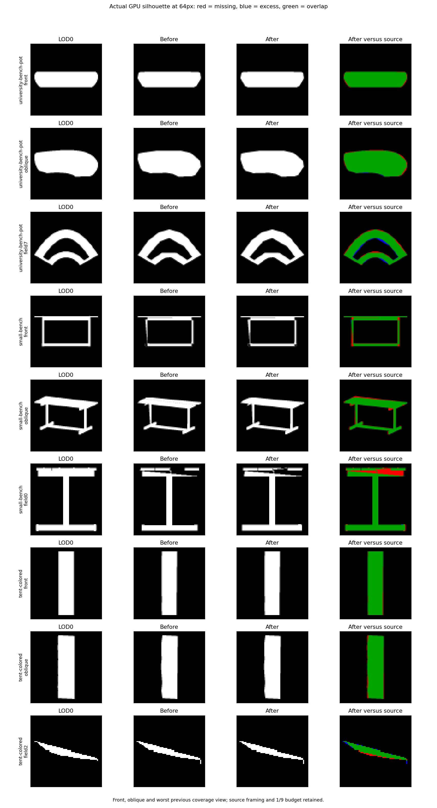
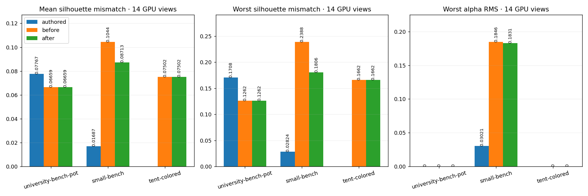
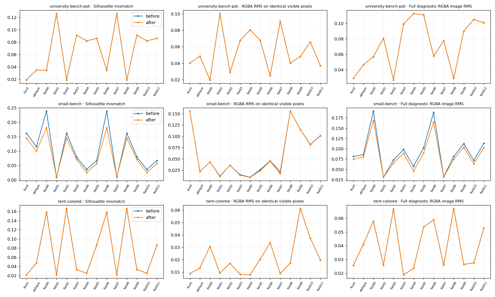
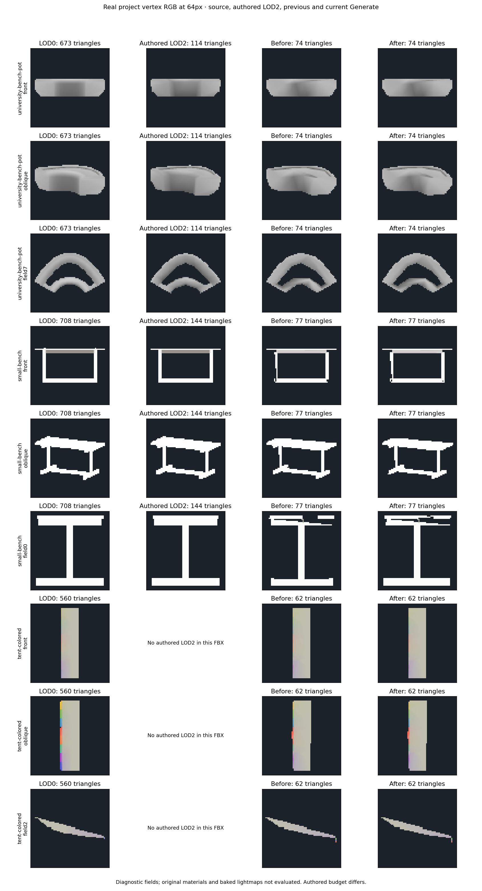
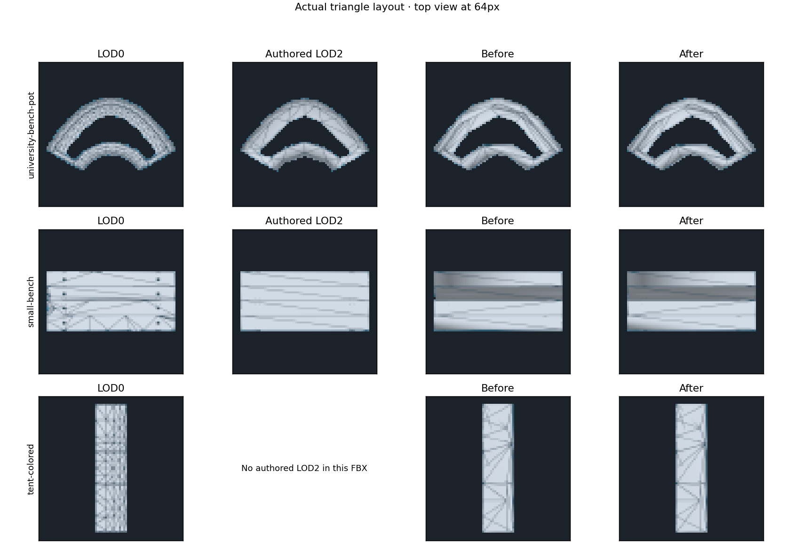

# Thin-frame silhouette refinement — 2026-10-11

This iteration starts silhouette work on the real SmallBench frame, retaining
independent source reduction to an LOD2 target of 1/9. University bench Pot and
the rainbow tent remain comparison fixtures. The baseline is `53f7689`, recorded
in [the gradient/boundary report](LOD_GRADIENT_BOUNDARIES.md).

## Implementation

Far silhouette refinement previously ran only above 10% mean coverage error.
SmallBench's 9.77% average hid a 23.45% worst-view error and 9.83% lost thin
details, so it bypassed this stage. It now also runs above 20% worst-view error
or 5% lost source details.

The existing deterministic coordinate descent retains indices, vertex count and
attribute buffers. Coincident render wedges move together; material interfaces
stay pinned. Each position moves at most two pixels using the maximum source
extent divided by the requested object footprint. Face winding and the existing
degeneracy checks remain in force. New triangle contacts relative to the initial
candidate are refused, and a vertex step cannot cross a nonincident face. The
sweep check also catches a step that passes completely through a thin surface
and ends without an intersection. Existing contacts may separate; this does not
certify an intersection-free input. Static meshes of up to 512 triangles and a
footprint up to 128px are supported; border-locked and deformed inputs bypass
this refinement.

Previously, an unconstrained geometric optimum was verified only after all moves.
On SmallBench it reached 3.31% mean and 5.55% worst CPU coverage error, but
primary RGBA RMS increased from 0.04077 to 0.23378 and source UV RMS from 0.15034
to 0.20389. That proposal was refused.

An owned temporary mesh now verifies each proposed group before committing its
coverage counts. A refusal restores positions and the objective, allowing other
groups to improve the silhouette. Across twelve source directions, mean/worst
coverage, worst thin-detail/paint loss, each sharp-pair view, and worst RGBA and
channel RMS must retain or improve. Individual-view RGBA/channel RMS may increase
by at most 1/255 relative to the **initial** candidate. The allowance cannot
accumulate across moves. Full-surface distance RMS/maximum and protected UV RMS
must retain or improve and sampled error must be finite.
Each silhouette view also retains or improves; mean/maximum improvements alone
cannot authorize damaging a previously good top view. Colorless or explicitly
unchecked inputs do not require nonexistent RGBA view arrays.

Each proposal additionally retains per-view coverage and color guards on a
128px source grid for a requested 64px footprint. This denser check addresses
changes that the four subsamples of one 64px CPU pixel can miss. The 64px guide
and actual 64px GPU evaluation remain the final measurements.

Final selection uses the same view allowance and keeps the primary paint,
silhouette and detail guards. The existing vertex-color classification and
transfer algorithms are unchanged; their normal/color correction stages still
evaluate the resulting geometry. After position refinement, surface attributes
are fitted and verified against all twelve directions as well as the primary
guide. An earlier six-view post-fit improved primary color but raised reverse
GPU RGBA error; it was rejected from this iteration. Temporary meshes are destroyed on refusal,
cancellation and exceptions. Original source arrays remain untouched.

These source UV measurements are correspondence diagnostics. They do not verify
a shared baked atlas or the project's original material shaders.

## Verification and next work

**264 selected EditMode tests pass, with zero failures or skips.** Both FBX
compile configurations and the identifier/dependency/diff gates pass. Five new
unit cases cover the mean-error dead zone, channel/UV and individual-view guards,
probe cleanup, new contacts including swept paths, and unevaluated color guides.
The real Generate regression evaluates the final mesh after all corrections.

The final real-model run uses Unity 6000.2.6f2, Direct3D12 and a GTX 980 Ti. The
physical 384px captures are area-filtered to a 64px maximum projected source
extent. Source and authored control readbacks remain byte-identical to the
baseline across front, oblique and twelve source directions.

| Mesh | LOD0 triangles | LOD2 triangles / vertices | GPU mean coverage error before → after | GPU worst coverage error before → after |
|---|---:|---:|---:|---:|
| University bench Pot | 673 | 74 / 71 | 6.659% → 6.659% | 12.618% → 12.618% |
| SmallBench | 708 | 77 / 125 | **10.435% → 8.713%** | **23.881% → 18.064%** |
| Rainbow tent | 560 | 62 / 154 | 7.502% → 7.502% | 16.617% → 16.617% |

SmallBench's worst mismatch falls **24.4% relative** with the same 77 triangles
(9.19x reduction). Thirty-nine accepted group moves retain the exact triangle,
RGBA, UV and tangent arrays and the 125 render vertices. Mean conditional GPU
RGBA RMS improves **0.059971 → 0.058940**; worst RGBA **0.155752 → 0.154033**;
worst alpha **0.184643 → 0.183131**. Maximum conditional per-view RGBA increase
is 0.000162. On the fixed common pixel set, maximum per-view increase is 0.000253.
Full-image RGBA RMS improves in **all fourteen views**: mean 0.094248 → 0.084525,
worst 0.191580 → 0.169121. The largest individual coverage increase is 0.001717,
inside the GPU 1/255 allowance; aggregate mean and worst coverage improve.

CPU mean/worst coverage improves 9.767%/23.453% → 7.996%/17.997%; worst lost
thin details improves 9.831% → 5.802%. Primary sharp-pair loss improves
0.726923 → 0.704701; it still fails the complete paint guide. Sampled source
distance RMS improves 0.018290 → 0.014734; maximum remains 0.169217. Protected
UV RMS improves **0.150340 → 0.136423**. These are correspondence measurements,
not a baked-lightmap test. University and tent's selected meshes and measured
RGBA/coverage are unchanged.

Observed two-level far generation times are 25.66s / **104.14s** / 22.51s versus
27.47s / **41.26s** / 23.15s. SmallBench's additional verification is expensive;
these are one-run timings, not a speed benchmark. Cache source projection/surface
data and restrict local re-evaluation before using this in large production
batches. The final isolated test project/results live on D: after C: filled
during intermediate runs; original project assets were not modified.

Full evidence: [LOD_SILHOUETTE_RESULTS.json](LOD_SILHOUETTE_RESULTS.json).
Conditional color aggregates and the source paint guide are also retained in
[the RGBA graph](LOD_SILHOUETTE_ERRORS.png) and [the guide graph](LOD_SILHOUETTE_GUIDE.png).

The authored SmallBench LOD2 uses 144 triangles and still has substantially better
coverage/color than this 77-triangle result. Missing thin members and the weak
alpha/color views remain; fixed-index refitting cannot restore deleted topology.
Protected LOD1 budget fallbacks are unchanged. Next: source-based part/triangle
allocation for the remaining frame, faster verification, then original material
and shared baked-lightmap checks. Further vertex-color algorithm experiments are
paused at the preceding conservative baseline.

Reproduce actual Generate with the three-case dataset and
`-meshlabLodBudget -meshlabLodHardEdges -meshlabLodFarBudget
-meshlabLodPaintDiagnostics -meshlabLodAuthored -meshlabLodAllColorViews
-meshlabLodGuideBaseline <53f7689-output> -meshlabLodSilhouetteRegression`.
Omit `-quit` and `-nographics`. Render/audit using
`python -B Tools~/render_lod_vertex_color_iteration.py <before> <after>
<cases.json> Documentation~/LOD_SILHOUETTE --silhouette`.

The real-model regression flag `-meshlabLodSilhouetteRegression` checks the
**final** generated mesh against `-meshlabLodGuideBaseline` across twelve CPU
directions, after every attribute and paint correction has finished. This checks
mean/worst coverage, detail/paint, worst RGBA/channels and the individual-view
allowance, so a later correction cannot silently undo a verified silhouette.

The plotting command with `--silhouette` separately checks fourteen actual GPU
views, unchanged source/authored GPU controls and FBX hashes, triangle/vertex
budgets, material slots, channel formats/dimensions and full-surface distance/UV
metrics. The next geometric step is source component/triangle allocation for
thin members that cannot be recovered by moving an existing fixed-topology
candidate.

GPU conditional RGBA RMS uses the source/target visible overlap, which changes
when the frame is restored. The report retains that metric and additionally
compares colors on one identical source/before/after pixel set. Full-image RGBA
RMS includes missing/excess coverage on the fixed diagnostic background. Per-view
GPU gates check coverage, the same-pixel channels and the full image, with a
1/255 allowance; aggregate mean/worst coverage and full-image RMS must retain or
improve. These additional measures prevent an apparent color improvement caused
only by excluding missing pixels.
