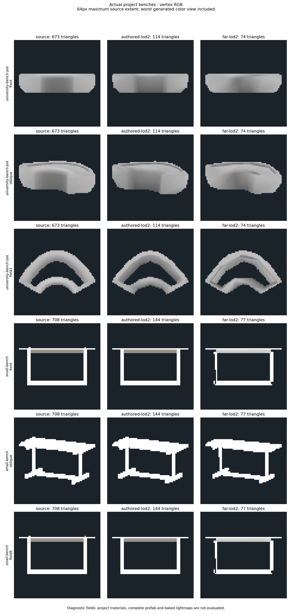
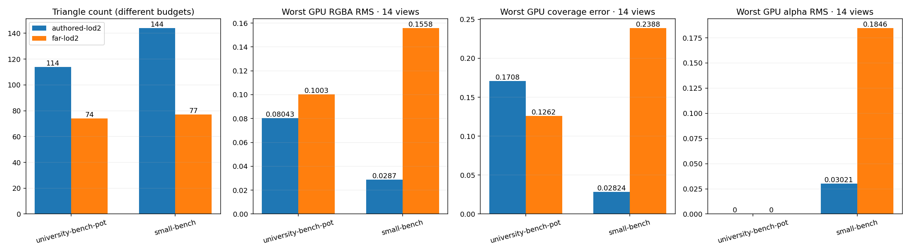

# Vertex-color generalization check — actual benches, 2026-10-10

Baseline at `0ffa5d2`. The following shared-corner iteration and its before/after
evidence are recorded in [LOD_SHARED_PAINT_PATCHES.md](LOD_SHARED_PAINT_PATCHES.md).

The source-driven attribute pipeline runs on other vertex-color models, but the
recent paint-diagonal stage does **not** generalize to these shared-corner meshes.
Neither new bench passes the complete color guide. This is measured validation
of the existing generator, not a production-quality certification or a generator
change.

## Inputs and scope

- `University_Bench_Planter_Arc_A.fbx`, selected mesh
  `University_Bench_Planter_Arc_A_Pot_LOD0`: 673 triangles, 474 vertices, one
  material slot, varying dark-to-light RGB and constant alpha. This is the actual
  asset referenced through its prefab in `Univer_interer.unity`; that scene
  instance is inactive. The separate `Ground` mesh has no vertex colors and is
  outside this color comparison. The full assembled prefab was not rendered.
- `SmallBench_01.fbx`, selected mesh `SmallBench_01_LOD0`: 708 triangles,
  792 vertices, two material slots, varying RGB and alpha (0.22745–1). This is an
  additional Apartments model from the same project, not a claimed university
  scene instance.

Original FBX bytes and SHA256 are retained. Tests import isolated readable copies
with compression disabled; original assets, prefab and scene are not edited.
The dataset explicitly selects the university component instead of silently
choosing the largest mesh in a multi-mesh FBX. Author LOD1/LOD2 are loaded from
the same FBX and group key, without regeneration.

Source hashes:

| Fixture | SHA256 |
|---|---|
| university-bench-pot | `b6912816d7978ba8a6faf9fa1d5ca7ae0b9d20f1c706b7cd4268e35933d4b0b2` |
| small-bench | `221c5a62fa4c8d3470e6ec45318727205a27bfb4e1b70d3af1aa4b10c04d7a41` |

## Actual Generate results

The same source-based far Screen Budget settings as the tent comparison are
used: LOD1/LOD2 targets 1/3 and 1/9, quality-ranked candidates, protected
near features, far relaxation, source RGBA fit and a 64px screen guide.

| Mesh | Source | Author LOD2 | Generated LOD2 | Render vertices | Generated LOD1 / target |
|---|---:|---:|---:|---:|---:|
| University bench Pot | 673 | 114 | **74** (9.09x reduction) | **71** | 673 / 225 |
| SmallBench | 708 | 144 | **77** (9.19x reduction) | **125** | 500 / 236 |

Both LOD2 budgets are reached. Both LOD1 budgets are missed under the existing
near protection policy. The protected native LOD2 controls retain 673 and 422
triangles respectively; this is reported as a fallback, not a successful 1/9
reduction. Color storage, UV channel dimensions and material-slot count are
retained. Retained storage/ranges do not imply retained per-pixel color.

Visible source RGBA fitting improves the six-view CPU worst RMS from
0.114156 to 0.100842 on the university mesh and 0.049086 to 0.040767 on SmallBench.
These are internal pre/post-fit measurements on each selected far candidate,
not comparisons with the author LOD2. Polygon-color proposals are refused on
both. SmallBench bypasses the one-material diagonal stage. The university mesh
enters it but has **zero eligible isolated six-corner pairs**: 61 of its 71 render
corners are shared across faces. Both resulting meshes have zero such pairs.
The stage therefore makes no geometric correction; no asset-name-specific
branch exists in production code.

## Fresh GPU check at 64px

GPU readbacks were captured on Unity 6000.2.6f2 / GTX 980 Ti / Direct3D12 at a
physical 384px render target. Each source frame is area-filtered to a **64px
maximum projected extent**, with its aspect ratio retained and a padded 72px
frame. Two standard views and twelve field views (six directions and their
opposites) are evaluated. RGBA RMS is linear and coverage-weighted over common
visible pixels; coverage error is measured separately. Different author/generated
triangle budgets are explicit. These are diagnostic vertex fields; original
materials, alpha semantics in those shaders and baked lightmaps are untested.

| Fixture | Mean GPU RGBA RMS, author / generated | Worst GPU RGBA RMS, author / generated | Worst coverage error, author / generated | Worst alpha RMS, author / generated |
|---|---:|---:|---:|---:|
| University bench Pot | 0.06617 / **0.05425** | 0.08043 / **0.10033** | 17.08% / **12.62%** | 0 / 0 |
| SmallBench | 0.01335 / **0.05997** | 0.02870 / **0.15575** | 2.82% / **23.88%** | 0.03021 / **0.18464** |

University front and oblique color RMS improve against the author LOD2
(0.05104 → 0.03986 and 0.05062 → 0.04834) despite fewer triangles. Its top view
is worse, even though aggregate mean and worst coverage improve. On SmallBench,
thin frame elements are visibly lost/distorted, front RGB correspondence is poor
and alpha drift is substantial in the diagonal reverse view. The source and
generated vertex alpha ranges both remain 0.22745–1; equal extrema do not prove
a correct transfer.

Both CPU detail guides pass while both color guides fail. The severe SmallBench
GPU coverage/color regressions show why two-camera evidence or a passing CPU
detail guide cannot establish general quality. The new case should remain in
the regression dataset before further tent-specific tuning.





Full measured fields and per-view/channel errors:
[LOD_VERTEX_COLOR_BENCHES_RESULTS.json](LOD_VERTEX_COLOR_BENCHES_RESULTS.json).

## Verification and reproduction

**57 selected EditMode tests pass, zero failures or skips**, including the fresh
Generate matrix on both new meshes. Passing tests validate execution, budget
reporting, source integrity and ownership; they do not require every model to
pass fidelity gates. Both FBX compile configurations and static dependency /
identifier checks pass. This iteration changes test selection/capture/reporting
only; production algorithms and native binaries are unchanged.

Raw current-code results: `_results~/lod-university-benches-20261010/final-views/`.
Cases: `_results~/lod-university-benches-20261010/cases.json`.
Portable report command:

```text
python -B Tools~/render_lod_vertex_color_models.py _results~/lod-university-benches-20261010/final-views _results~/lod-university-benches-20261010/cases.json Documentation~/LOD_VERTEX_COLOR_BENCHES
```

Capture flags for `LodProjectVisualQualityTests`:
`-meshlabLodProjectCases <dataset> -meshlabLodVisualOutput <output>
-meshlabLodBudget -meshlabLodHardEdges -meshlabLodFarBudget
-meshlabLodPaintDiagnostics -meshlabLodAuthored -meshlabLodAllColorViews`.
Omit `-nographics` and `-quit` when launching the EditMode test runner.
The test dataset supports an optional exact `meshName`; absent it, the existing
largest non-collision/non-later-LOD selection is retained.

Next priorities: diagnose SmallBench thin-frame allocation and its weak RGB/alpha
views at the 1/9 budget; extend source-derived patch correction to shared render
corners and material-separated meshes; compare every accepted candidate with
the weak GPU views and source UV2. Keep the current refusal checks, the author
controls and explicit LOD1 budget failures. Full materials and shared lightmap
verification follow; normal matching remains a secondary LOD2 concern.
